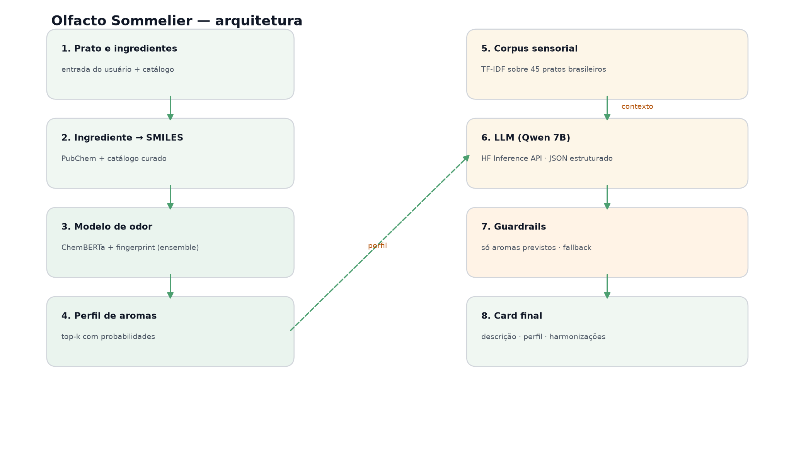
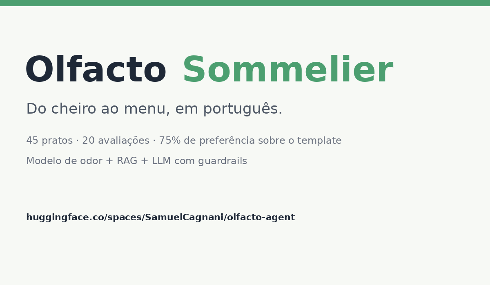

# Olfacto AI

Predição aberta de odor molecular, do SMILES ao aroma em português.

[](https://github.com/cagnani/olfacto-ai/actions/workflows/ci.yml)

## Por que importa

O Olfacto tem duas camadas:

1. **Um modelo aberto de odor.** Recebe a estrutura de uma molécula (SMILES) e prevê a
   probabilidade de 138 descritores olfativos — frutado, floral, defumado, amadeirado.
2. **Um agente de produto.** O **Olfacto Sommelier** transforma um prato em descrição de
   menu, perfil sensorial e harmonizações, usando o modelo de odor como ferramenta.

O achado central do projeto é honesto: neste dataset, um baseline clássico de fingerprints
Morgan + regressão logística **supera** o transformer pequeno. O ensemble dos dois chega a
0,8402 de ROC-AUC macro out-of-fold. O agente não esconde isso; ele usa o ensemble e declara
as limitações.

## Artefatos

| Artefato | Link |
|---|---|
| Modelo | [SamuelCagnani/olfacto-chemberta-138](https://huggingface.co/SamuelCagnani/olfacto-chemberta-138) |
| Dataset | [SamuelCagnani/olfacto-odor-138-ptbr](https://huggingface.co/datasets/SamuelCagnani/olfacto-odor-138-ptbr) |
| Demo do modelo | [Space Olfacto](https://huggingface.co/spaces/SamuelCagnani/olfacto-live) |
| **Sommelier** | [Space Olfacto Sommelier](https://huggingface.co/spaces/SamuelCagnani/olfacto-agent) |
| Showcase estático | [Space estático](https://huggingface.co/spaces/SamuelCagnani/olfacto) |
| Artigo v1 (PT-BR) | [Ensinando uma IA a sentir cheiro](https://huggingface.co/blog/SamuelCagnani/olfacto-ai-br) |
| Artigo v1 (EN) | [docs/article-en.md](docs/article-en.md) |
| Artigo do agente | [PT-BR](docs/hf-blog-agent-ptbr.md) · [EN](docs/hf-blog-agent-en.md) |
| Avaliação do agente | [docs/agent-eval.md](docs/agent-eval.md) |
| Kaggle (treino) | [cagnani/olfacto-ai](https://www.kaggle.com/code/cagnani/olfacto-ai) |
| Kaggle (análise) | [notebooks/03_sommelier_kaggle.ipynb](notebooks/03_sommelier_kaggle.ipynb) |
| Collection | [Olfacto AI](https://huggingface.co/collections/SamuelCagnani/olfacto-ai-6afc73d3fbdb504d0b2edaab) |

## Arquitetura

### Modelo (v1)

```
SMILES → tokenização por caractere → ChemBERTa (3 camadas, 384 dims)
       → cabeça multi-label (138 saídas) → sigmoide → aromas em PT-BR
```

- **Dados:** 4.983 moléculas do dataset curado do [OpenPOM](https://github.com/ARY2260/openpom),
  derivado dos catálogos GoodScents e Leffingwell. Média de 4,88 rótulos por molécula.
- **Modelo:** fine-tune de `DeepChem/ChemBERTa-77M-MLM`, loss BCE com `pos_weight` por rótulo
  (limitado a 20) para lidar com o desbalanceamento extremo (`fruity` 1.902 vs `chamomile` 31).
- **Ensemble:** fingerprints Morgan (2.048 bits, raio 2) + regressão logística por rótulo,
  combinados com o transformer (peso 0,8 para o fingerprint, escolhido out-of-fold).
- **Validação:** 5-fold com estratificação iterativa multi-label, métricas out-of-fold.
- **Interpretação:** embeddings projetados com UMAP para o mapa de cheiros.

### Agente (v2)



O Sommelier liga um prato a ingredientes, resolve o SMILES de uma molécula marcante de cada
ingrediente, consulta o modelo de odor, recupera contexto sensorial com TF-IDF e pede ao LLM
uma descrição em JSON. O LLM **não decide aromas**: ele recebe a lista prevista e escreve a
partir dela. Se o JSON falhar ou citar um aroma fora da lista, há uma nova tentativa e depois
um fallback determinístico.

## Resultados

### Modelo de odor

Validação cruzada de 5 folds, métricas out-of-fold:

| Modelo | ROC-AUC macro |
|---|---|
| OpenPOM (MPNN, ensemble de 10) | 0.8872 |
| **Olfacto Ensemble (80% fingerprint + 20% ChemBERTa)** | **0.8402** |
| Morgan + LogReg | 0.8285 |
| ChemBERTa (modelo único) | 0.7516 |

O ChemBERTa sozinho tem ROC-AUC micro 0.8402 e, por rótulo, vai bem em notas sulfurosas
(alho 0.971, cebola 0.967) e mal em frutas finas (morango 0.461, uva 0.508). A comparação com
o OpenPOM é uma ablation, não uma disputa de arquitetura. Tabela completa em
[`docs/results.md`](docs/results.md).

### Agente

Benchmark de 20 pratos, com um juiz LLM comparando as descrições lado a lado:

| Métrica | Valor |
|---|---|
| Pratos no corpus | 45 em 8 categorias |
| Cobertura do LLM | 95% |
| Fidelidade do perfil | 100% |
| Fidelidade da descrição | 75% |
| Harmonizações com 3 itens únicos | 100% |
| Preferência sobre o template | 75% (15/20) |
| Latência p50 / p95 | 2,9s / 4,9s |

O perfil estruturado é 100% fiel porque o guardrail rejeita aromas fora da lista. A descrição
é mais difícil de validar: o LLM às vezes acrescenta termos plausíveis que não estão no top-k.
Detalhes e limitações em [`docs/agent-eval.md`](docs/agent-eval.md).

## Demo



- Modelo: [Space Olfacto](https://huggingface.co/spaces/SamuelCagnani/olfacto-live)
- Agente: [Space Olfacto Sommelier](https://huggingface.co/spaces/SamuelCagnani/olfacto-agent)
- Showcase estático: [Space estático](https://huggingface.co/spaces/SamuelCagnani/olfacto)

## Uso rápido

```bash
make install
make test
make lint
```

Inferência do modelo:

```python
from olfacto.predict import OdorPredictor

predictor = OdorPredictor.from_pretrained(
    "SamuelCagnani/olfacto-chemberta-138",
    "data/odor_labels_ptbr.json",
)
for prediction in predictor.predict("CCO", top_k=5):
    print(f"{prediction.label_pt_br}: {prediction.probability:.2f}")
```

Agente local (precisa de `HF_TOKEN` com permissão de Inference Providers):

```bash
uv sync --extra train --extra app --extra chem --extra hf
uv run --extra train --extra app --extra chem --extra hf python agent_space/app.py
```

## Dataset

O dataset no Hugging Face contém:

| Arquivo | Conteúdo |
|---|---|
| `curated_GS_LF_merged_4983.csv` | SMILES, descritores textuais e 138 rótulos binários |
| `odor_labels_ptbr.json` | tradução PT-BR e família olfativa dos 138 rótulos |
| `brazilian_ingredients.csv` | ~40 ingredientes brasileiros e moléculas marcantes |
| `map.csv` | projeção UMAP dos embeddings |
| `agent/sommelier_ingredients.csv` | 38 ingredientes salgados e moléculas marcantes |
| `agent/dish_ingredients.json` | 45 pratos em 8 categorias e seus ingredientes |
| `agent/sensory_corpus.jsonl` | 45 descrições sensoriais originais |
| `agent/eval_results.csv` | benchmark de 20 pratos do agente |
| `images/` | diagramas, gráficos e GIF do projeto |

## Reprodutibilidade

```bash
# treino e validação cruzada
uv sync --extra train
uv run --extra train python scripts/run_cv.py --output-dir outputs/cv --final

# mapa, resultados e avaliação do agente
uv run --extra train --extra app python scripts/build_map.py
uv run --extra train python scripts/render_results.py
uv run --extra train --extra app --extra chem python scripts/evaluate_agent.py

# imagens e GIF
uv run --extra train --extra app --extra chem --extra assets python scripts/build_article_assets.py
uv run --extra train --extra app --extra chem python scripts/build_agent_gif.py
```

Os testes rodam em CPU, sem rede: `make test`.

## Kaggle

- **Treino:** https://www.kaggle.com/code/cagnani/olfacto-ai — reproduz a validação cruzada de
  5 folds e treina o modelo final. No run atual: OOF macro 0,7520 e micro 0,8404.
- **Análise:** `notebooks/03_sommelier_kaggle.ipynb` — EDA do desbalanceamento, baseline
  Morgan + LogReg e inferência do ChemBERTa. Instruções em [`docs/kaggle.md`](docs/kaggle.md).

## Estrutura

```
src/olfacto/
  data.py, labels.py, train.py, evaluate.py, predict.py, map.py, ingredients.py, cards.py
  agent/            tools, retrieval, prompts, pipeline, evaluate
agent_space/        app Gradio do Sommelier
space/              app Gradio do modelo
space_static/       showcase estático
data/               catálogos, corpus, mapa, avaliação
notebooks/          02 treino, 03 análise
scripts/            cv, mapa, avaliação, assets, GIF, publicação
tests/              testes em CPU, sem rede
docs/               artigos, cards, resultados, avaliação, imagens
```

## Limitações

**Modelo de odor**

- Prevê **qualidade**, não intensidade.
- Só moléculas únicas, não misturas.
- Rótulos de catálogo são ruidosos e enviesados para fragrâncias comerciais.
- Não é adequado para uso regulatório, médico ou de segurança alimentar.
- O modelo sempre retorna os aromas mais próximos que conhece.

**Agente**

- O juiz é um LLM, não um painel humano; as notas servem para comparação relativa.
- O benchmark tem 20 pratos e não cobre todo o cardápio.
- Harmonizações são sugestões, não recomendações gastronômicas validadas.
- A descrição pode acrescentar termos plausíveis fora do top-k (fidelidade de 75%).
- Sem alegação de alérgenos, saúde ou segurança alimentar.

## O que eu aprendi

O maior ganho não veio do modelo, e sim de tratar o desbalanceamento com seriedade e de rodar
o baseline burro. O Morgan + regressão logística venceu o transformer pequeno; o ensemble
recuperou o melhor dos dois.

No agente, a parte difícil não foi chamar o LLM. Foi desenhar o contrato: o que ele pode dizer,
o que não pode, e o que acontece quando falha. O fallback determinístico é uma feature.

## Citação e licença

Dados originais: Lee et al. (2023), *A Principal Odor Map Unifies Diverse Tasks in Human
Olfactory Perception*, Science. Código de referência: OpenPOM (MIT).

Este projeto é MIT. Veja [`docs/results.md`](docs/results.md) e
[`docs/agent-eval.md`](docs/agent-eval.md) para os números completos.
